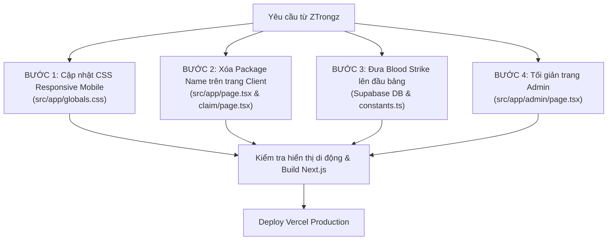

# PHƯƠNG ÁN ĐIỀU PHỐI GETKEY: TỐI ƯU GIAO DIỆN MOBILE & ĐIỀU CHỈNH DANH SÁCH GAME

**Mã lệnh điều phối:** `DIR-GETKEY-UI-20261105-01`  
**Hệ thống mục tiêu:** Dự án `GETKEY` (`https://hiroki-panel.vercel.app`)  
**Người yêu cầu:** ZTrongz  
**Đơn vị thực thi:** Đội ngũ phát triển `GETKEY`  
**Đơn vị điều phối:** KLP Master Controller  
**Ngày ban hành:** 05/11/2026  

---

## 1. TỔNG QUAN YÊU CẦU & BỐI CẢNH

Qua phản hồi thực tế từ ZTrongz khi thao tác trên thiết bị di động thực tế:
1. **Lỗi tràn khung (Mobile Overflow):** Giao diện khi mở trên điện thoại bị vỡ khung ngang, chữ và badge trạng thái (*"Hoạt động"*, mũi tên điều hướng, nút hỗ trợ) bị tràn văng ra ngoài khung thẻ viền kính (`.hiroki-card`).
2. **Thứ tự ưu tiên Game:** Cần đưa tựa game trọng tâm **Blood Strike** lên vị trí đầu tiên của danh sách chọn game.
3. **Ẩn thông tin kỹ thuật (Package Name) trên trang Người dùng (`/` và `/claim`):** Xóa bỏ hoàn toàn dòng chữ `Package Name` (như `com.garena.game.kgvn...`) nằm bên dưới tên game ở nút chọn và menu thả xuống.
4. **Loại bỏ Package Name trong mục Cấu hình Game trang Quản trị (`/admin`):** Ẩn/xóa bỏ cột và trường nhập `Package Name` để giao diện quản trị tinh gọn, thân thiện và không gây rối mắt.

---

## 2. PHÂN TÍCH NGUYÊN NHÂN GỐC RỄ (ROOT CAUSE ANALYSIS)

### 2.1. Lỗi tràn khung trên Mobile
1. **Thiếu hoàn toàn Responsive Media Queries:** Trong tệp [globals.css](file:///F:/Documents/GETKEY/src/app/globals.css), không có bất kỳ cú pháp `@media (max-width: 480px)` nào. Độ đệm padding của thẻ `.hiroki-card` cố định ở mức `28px 26px` (chiếm tới 52px chiều rộng).
2. **Xung đột chiều rộng thanh tiện ích trên cùng (`.top-bar`):** Chứa cụm 3 nút chuyển đổi ngôn ngữ (`VI`, `EN`, `ZH`) và 2 nút tiện ích (*"Hướng dẫn"*, *"Hỗ trợ"*). Tổng chiều ngang cần thiết vượt quá 305px, trong khi ruột thẻ trên màn hình điện thoại 360px chỉ còn `360 - 32 - 52 = 276px`, gây tràn mép phải.
3. **Khối chọn game không co giãn (`.game-trigger-left`):**
   - Khối chứa tên game và chuỗi package name không được thiết lập `min-width: 0` và `flex: 1`.
   - Chuỗi package name của Liên Quân Mobile rất dài (`com.garena.game.kgvn,com.garena.game.kgvo,com.garena.game.kgvn64x`), cố định `max-width: 260px`.
   - Kết hợp với icon game (42px) và khoảng cách, phần bên trái chiếm trọn diện tích, đẩy cụm bên phải (`.badge-pill` và icon chevron) văng hoàn toàn ra ngoài biên phải của thẻ card.

### 2.2. Thứ tự hiển thị Game
- Trong bảng cơ sở dữ liệu `public.games` trên Supabase:
  - `Liên Quân Mobile` đang có `sort_order = 3`.
  - `Blood Strike Mobile (VIP Mod)` đang có `sort_order = 4`.
  - Do `3 < 4`, hệ thống tự động sắp xếp Liên Quân đứng trước Blood Strike.
- Trong tệp mã nguồn [constants.ts](file:///F:/Documents/GETKEY/src/lib/constants.ts), `Blood Strike` cũng đang xếp ở vị trí cuối cùng với `sort_order = 4`.

---

## 3. KẾ HOẠCH THI CÔNG CHI TIẾT



---

### BƯỚC 1: SỬA LỖI RESPONSIVE MOBILE TRONG `globals.css`

Mở tệp: [src/app/globals.css](file:///F:/Documents/GETKEY/src/app/globals.css)

#### 1.1. Sửa thuộc tính co giãn của khối chọn Game:
Tìm khối `.game-trigger-left` và cập nhật để phần text tự động co rút khi màn hình hẹp:
```css
/* Cập nhật trong src/app/globals.css */

.game-trigger {
  width: 100%;
  display: flex;
  align-items: center;
  justify-content: space-between;
  gap: 8px; /* Đảm bảo có khoảng cách tối thiểu giữa 2 vế */
  background: var(--bg-elevated);
  border: 1px solid var(--border-subtle);
  border-radius: var(--radius-md);
  padding: 12px 14px;
  cursor: pointer;
  color: var(--text-main);
  transition: all 0.2s ease;
  overflow: hidden; /* Ngăn chặn tràn viền */
}

.game-trigger-left {
  display: flex;
  align-items: center;
  gap: 12px;
  text-align: left;
  flex: 1;          /* Bắt buộc: Chiếm phần không gian khả dụng */
  min-width: 0;     /* Bắt buộc: Cho phép text bên trong thu gọn */
  overflow: hidden;
}

.game-title-text {
  font-weight: 700;
  font-size: 15px;
  color: var(--text-main);
  white-space: nowrap;
  overflow: hidden;
  text-overflow: ellipsis; /* Tên dài sẽ hiển thị dấu ... thay vì tràn */
}

/* Badge trạng thái luôn giữ kích thước cố định, không bị bóp nghẹt */
.badge-pill {
  font-size: 10.5px;
  font-weight: 700;
  padding: 3px 8px;
  border-radius: 999px;
  white-space: nowrap;
  flex-shrink: 0;
}
```

#### 1.2. Thêm Media Queries tối ưu toàn diện cho thiết bị di động:
Bổ sung đoạn CSS sau vào cuối tệp [globals.css](file:///F:/Documents/GETKEY/src/app/globals.css):
```css
/* ==========================================================
   MOBILE RESPONSIVE ENHANCEMENTS (Tối ưu màn hình điện thoại)
   ========================================================== */
@media (max-width: 480px) {
  .hiroki-shell {
    padding: 16px 12px;
    overflow-x: hidden;
  }

  .hiroki-card {
    padding: 20px 14px;
    border-radius: 18px;
  }

  /* Top bar thu gọn padding và cỡ chữ */
  .top-bar {
    gap: 6px;
    margin-bottom: 16px;
  }

  .lang-group {
    padding: 2px;
    gap: 2px;
  }

  .lang-btn {
    font-size: 11px;
    padding: 4px 7px;
  }

  .icon-btn {
    font-size: 11.5px;
    padding: 5px 9px;
    gap: 4px;
  }

  /* Brand Header */
  .brand-header {
    margin-bottom: 16px;
  }

  .brand-avatar-wrap {
    width: 72px;
    height: 72px;
    margin-bottom: 8px;
  }

  .brand-title {
    font-size: 22px;
  }

  .brand-subtitle {
    font-size: 12.5px;
  }

  /* Thông báo banner */
  .announcement-bar {
    font-size: 12px;
    padding: 8px 10px;
    margin-bottom: 14px;
  }

  /* Game item trong menu xổ xuống */
  .game-option-item {
    padding: 8px 10px;
  }

  .game-icon-img {
    width: 36px;
    height: 36px;
  }
}
```

---

### BƯỚC 2: XÓA DÒNG PACKAGE NAME TRÊN TRANG NGƯỜI DÙNG

#### 2.1. Cập nhật trang chủ: [src/app/page.tsx](file:///F:/Documents/GETKEY/src/app/page.tsx)
1. **Tại nút kích hoạt chọn game (khoảng dòng 358-362):**
   *Mã nguồn hiện tại:*
   ```tsx
   <div>
     <div className="game-title-text">{selectedGame.game_name}</div>
     <div className="game-pkg-sub">{selectedGame.package_name}</div>
   </div>
   ```
   *Thay thế bằng (xóa bỏ thẻ `game-pkg-sub`):*
   ```tsx
   <div style={{ minWidth: 0 }}>
     <div className="game-title-text">{selectedGame.game_name}</div>
   </div>
   ```

2. **Tại danh sách lựa chọn trong menu dropdown (khoảng dòng 401-405):**
   *Mã nguồn hiện tại:*
   ```tsx
   <div>
     <div className="game-title-text">{g.game_name}</div>
     <div className="game-pkg-sub">{g.package_name}</div>
   </div>
   ```
   *Thay thế bằng (xóa bỏ thẻ `game-pkg-sub`):*
   ```tsx
   <div style={{ minWidth: 0 }}>
     <div className="game-title-text">{g.game_name}</div>
   </div>
   ```

#### 2.2. Cập nhật trang trả Key: [src/app/claim/page.tsx](file:///F:/Documents/GETKEY/src/app/claim/page.tsx)
Tại dòng 276-279:
*Mã nguồn hiện tại:*
```tsx
<div style={{ display: 'flex', justifyContent: 'space-between', fontSize: 12, color: 'var(--text-secondary)', marginTop: 10 }}>
  <span>Gói Game: {mintedKey.game_package}</span>
  <span>Giới hạn: {mintedKey.max_devices} Thiết bị Game</span>
</div>
```
*Thay thế bằng (ẩn chuỗi package name, chỉ hiển thị trạng thái thiết bị):*
```tsx
<div style={{ display: 'flex', justifyContent: 'center', fontSize: 12, color: 'var(--text-secondary)', marginTop: 10 }}>
  <span>Giới hạn: {mintedKey.max_devices === 0 ? 'Không giới hạn' : `${mintedKey.max_devices} Thiết bị`}</span>
</div>
```

---

### BƯỚC 3: ĐƯA GAME BLOOD STRIKE LÊN ĐẦU DANH SÁCH

#### 3.1. Cập nhật trong Cơ sở dữ liệu Supabase:
Chạy truy vấn SQL trực tiếp trên Supabase SQL Editor:
```sql
-- Đặt Blood Strike lên vị trí đầu tiên (sort_order = 1)
UPDATE public.games 
SET sort_order = 1 
WHERE package_name = 'com.netease.newspike';

-- Cập nhật lại các tựa game khác theo thứ tự phía sau
UPDATE public.games 
SET sort_order = 2 
WHERE package_name LIKE 'com.garena.game.kgvn%';

UPDATE public.games 
SET sort_order = 3 
WHERE package_name = 'com.vng.speedvn';

UPDATE public.games 
SET sort_order = 4 
WHERE package_name = 'com.mobile.legends';

-- Đảm bảo trạng thái Blood Strike luôn được kích hoạt
UPDATE public.games 
SET is_active = true 
WHERE package_name = 'com.netease.newspike';
```

#### 3.2. Cập nhật danh sách mặc định trong mã nguồn: [src/lib/constants.ts](file:///F:/Documents/GETKEY/src/lib/constants.ts)
Đảo phần tử `Blood Strike` lên đầu danh sách mảng `DEFAULT_GAMES` với `sort_order: 1`:
```typescript
export const DEFAULT_GAMES: DefaultGameItem[] = [
  {
    package_name: 'com.netease.newspike',
    game_name: 'Blood Strike',
    icon_url: '/assets/images/bloodstrike.png',
    is_active: true,
    maintenance_msg: '',
    min_version: '1.0.0',
    download_url: '',
    features_json: [
      'ESP Khung xương & Khoảng cách',
      'Hiện thanh máu & tên vũ khí',
      'Aimbot tâm mượt tùy chỉnh FOV',
      'Giảm giật đạn (No Recoil)',
      'Cảnh báo địch ngắm từ xa',
    ],
    sort_order: 1, // Ưu tiên số 1
  },
  {
    package_name: 'com.garena.game.kgvn,com.garena.game.kgtw,com.garena.game.kgth',
    game_name: 'Liên Quân Mobile',
    icon_url: '/assets/images/lienquan.png',
    is_active: true,
    maintenance_msg: '',
    min_version: '1.0.0',
    download_url: '',
    features_json: [
      'Hack Map sáng 100%',
      'Hiện thời gian hồi chiêu & phép bổ trợ',
      'Cam xa 3 nấc mượt mà',
      'Hiện khung viền & máu địch',
      'Aim Elsu tự động chuẩn xác',
    ],
    sort_order: 2,
  },
  {
    package_name: 'com.vng.speedvn',
    game_name: 'ZingSpeed Mobile',
    icon_url: '/assets/images/zingspeed.png',
    is_active: true,
    maintenance_msg: '',
    min_version: '1.0.0',
    download_url: '',
    features_json: [
      'Hiện đường dẫn',
      'Hiện thời gian hồi vật phẩm (đạo cụ)',
      'Auto CWW, WCW (Đua tốc độ)',
      'Auto bấm tinh linh',
      'Nhìn xuyên tường & cảnh báo tên lửa',
    ],
    sort_order: 3,
  },
  {
    package_name: 'com.mobile.legends',
    game_name: 'Mobile Legends: Bang Bang',
    icon_url: '/assets/images/mlbb.png',
    is_active: true,
    maintenance_msg: '',
    min_version: '1.0.0',
    download_url: '',
    features_json: [
      'Hack Map sáng toàn bản đồ',
      'Hiện lịch sử đấu & ẩn tên',
      'Hiện thời gian hồi chiêu địch',
      'Hiện vị trí địch trong bụi cỏ',
      'Camera góc nhìn siêu rộng (Drone View)',
    ],
    sort_order: 4,
  },
];
```

---

### BƯỚC 4: LOẠI BỎ PACKAGE NAME TRÊN TRANG ADMIN

Mở tệp: [src/app/admin/page.tsx](file:///F:/Documents/GETKEY/src/app/admin/page.tsx)

#### 4.1. Trong Bảng danh sách Cấu hình Game:
1. Xóa tiêu đề cột `<th>Package Name</th>` (khoảng dòng 1277).
2. Xóa ô dữ liệu hiển thị `<td style={{ fontFamily: 'JetBrains Mono', fontSize: 12 }}>{g.package_name}</td>` (khoảng dòng 1296).

#### 4.2. Trong Modal Thêm / Sửa Cấu hình Game:
1. Xóa trường nhập Package Name khỏi form (khoảng dòng 1361-1374):
   *Xóa khối này:*
   ```tsx
   <div className="form-field" style={{ marginBottom: 12 }}>
     <label>Package Name (Dùng dấu phẩy nếu nhiều package, ví dụ Liên Quân):</label>
     <input
       type="text"
       className="hiroki-input"
       value={gameModalData.package_name || ''}
       onChange={(e) =>
         setGameModalData({ ...gameModalData, package_name: e.target.value.trim() })
       }
       placeholder="com.vng.speedvn"
       required
     />
   </div>
   ```
2. Để đảm bảo cơ chế lưu game (hàm `handleSaveGame`) không bị lỗi khi thêm game mới:
   Khi thêm game mới, nếu chưa có `package_name`, tự động sinh mã ẩn theo tên game:
   ```typescript
   const handleSaveGame = async (e: React.FormEvent) => {
     e.preventDefault();
     if (!gameModalData?.game_name) return;

     // Nếu là game mới chưa có package_name, tự động tạo slug định danh ngầm
     const pkg = gameModalData.package_name || 
       'game.' + gameModalData.game_name.toLowerCase().replace(/[^a-z0-9]/g, '_');

     try {
       const res = await fetch('/api/admin/games', {
         method: 'POST',
         headers: { 'Content-Type': 'application/json' },
         body: JSON.stringify({
           ...gameModalData,
           package_name: pkg,
           features_json: gameFeaturesRaw
             .split('\n')
             .map((s) => s.trim())
             .filter(Boolean),
         }),
       });
       // ... giữ nguyên phần xử lý kết quả
   ```

#### 4.3. Trong Dropdown tạo Key mới (Mục Quản lý Key):
Tại dòng 897-899:
*Thay thế:*
```tsx
<option key={g.package_name} value={g.package_name}>
  {g.game_name} ({g.package_name})
</option>
```
*Bằng giao diện sạch chỉ có tên game:*
```tsx
<option key={g.package_name} value={g.package_name}>
  {g.game_name}
</option>
```

---

## 5. QUY TRÌNH KIỂM TRA CHẤT LƯỢNG (VERIFICATION CHECKLIST)

Sau khi đội ngũ `GETKEY` hoàn thành các sửa đổi, tiến hành nghiệm thu theo các tiêu chí:

| Hạng mục kiểm tra | Tiêu chuẩn đạt |
| :--- | :--- |
| **Giao diện Điện thoại (Mobile)** | Mở trang web trên Safari/Chrome mobile (kích thước từ 360px đến 414px): Card nằm gọn gàng, viền bo không bị cắt, không có thanh cuộn ngang, nút *"Hoạt động"* và icon chevron nằm trọn vẹn bên trong khung viền bo góc. |
| **Trang chủ (`/`)** | Nút game và dropdown menu chỉ hiển thị Logo + Tên Game (ví dụ: *Blood Strike*, *Liên Quân Mobile*), không còn bất kỳ dòng package name nào. |
| **Vị trí Game mặc định** | Game **Blood Strike** tự động được chọn mặc định ngay khi người dùng vừa truy cập trang. Menu dropdown hiển thị Blood Strike ở vị trí trên cùng. |
| **Trang Admin (`/admin`)** | Bảng "Danh Sách Game & Công Tắc Bảo Trì" không còn cột Package Name. Modal chỉnh sửa game không còn trường nhập Package Name. |
| **Chức năng Lấy Key** | Bấm lấy key game Blood Strike vẫn hoạt động trơn tru 100%, trả về mã key hợp lệ với đầy đủ chữ ký Ed25519. |

---

*Tài liệu điều phối được phê duyệt và lưu trữ tại [PHUONG_AN_FIX_UI_MOBILE_VA_DANH_SACH_GAME.md](file:///f:/Documents/Control_GETKEY-Crack/PHUONG_AN_FIX_UI_MOBILE_VA_DANH_SACH_GAME.md)*
